# Dashboard shapes

Named design recipes the new-dashboard wizard offers and the Assistant's draft builds from, and
the published page brought up to the same look. Started from a comparison with a Claude-made
dashboard ("US state populations, 2024"), whose dashboard type ships a design guide plus named
shapes; a person can pick one, or the model picks.

## The four shapes

One registry, one entry per shape: `src/analysis/dashboardShapes.ts`. Each entry says its layout
on the 12-column grid in the plan's own row words, which chart kinds answer which question, how
titles and notes read, and where the takeaway goes. `shapeText` writes the model's sentence from
those fields, so the prompt cannot drift from the data (`scripts/test-dashboardShapes.ts` checks
every quoted term against the plan's vocabularies, and that no sentence holds a figure).

| Shape | Layout | Build effects |
|---|---|---|
| **Scorecard** | four to six KPI tiles (4 × 3 cells, three to a line), then at most one chart | every KPI gets `trend: true`: its months and the change in its latest month |
| **Review** | a few totals, ONE chart over time (7 rows tall), small multiples on one scale (`facet: {cols, scale: 'shared'}`) | taller charts |
| **Visual analysis** | one chart per question-phrased section, no KPI row | the first series in the accent, the rest muted (`overrides.accent`) |
| **Table** | one tall `table` chart, controls to narrow it | sortable, searchable, bars in its cells (`overrides.richTable`) |

The brief's old "Kind" (explore / overview / report) is replaced by "Shape" with "Assistant picks"
as the default. `analysis:draft` takes `shape` (an id or `auto`); a chosen shape is forced onto the
plan whatever the model wrote, and with `auto` the model's pick stands only if it names a shape.

## Figures stay the engine's

- **Takeaway.** Under the title, on the canvas (`analysis:takeaway`) and at `/p/` alike: the
  app's caption (`analysis/captions.ts`) of the first chart in reading order, under the sheet's
  filters. The draft review shows the same sentence from `previewPlan`. A model writes none of it.
- **Notes.** A chart's one-line note is the model's words; a note holding a digit is dropped
  (`planNote`). A person's own note (`Card.note`) keeps its digits.
- **KPI trend.** `src/ipc/kpiTrend.ts` reads the measure by month through `vizDataFor`, the chart
  door, and computes the latest change on the server (equal to the chart's figures with `Object.is`).
- **Accent, table bars.** Drawing only: a muted colour token, a bar's length against its column's
  largest value. Sorting orders rows; it computes nothing.

## Published page

Full width (`.pub-root` no longer centres a 1240px column), sentence-case titles with the note
under them, KPI tiles as a label over the figure with the change coloured good/bad and a trend,
the takeaway under the title. A filter bar showed "State" and "Growth direction" twice because
`controlSpecs` collected the same control from every sheet; identical controls now publish once.
The single-filter hint reads "Pick one filter at a time — the others reset."

## Screens

Before and after, the sample dashboard published (Category and State on two sheets, Compare on):

| Before | After |
|---|---|
| 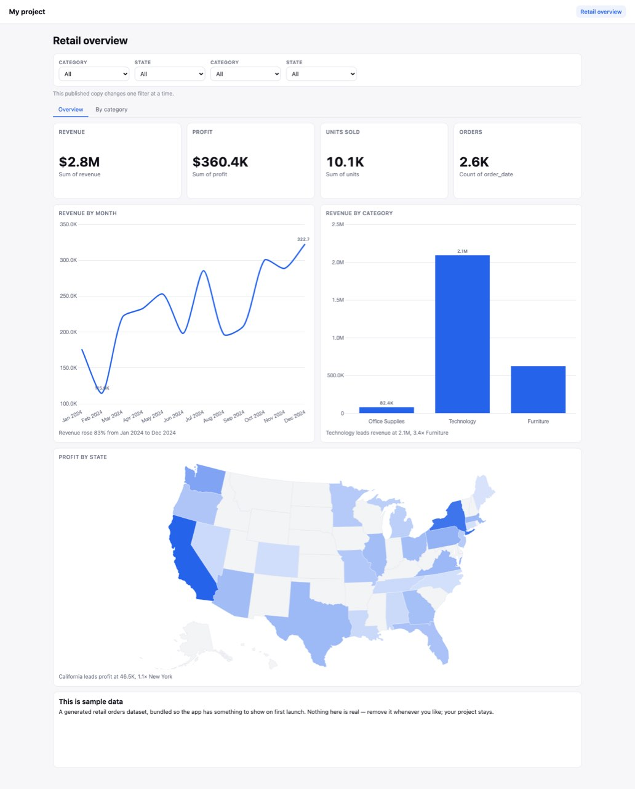 | 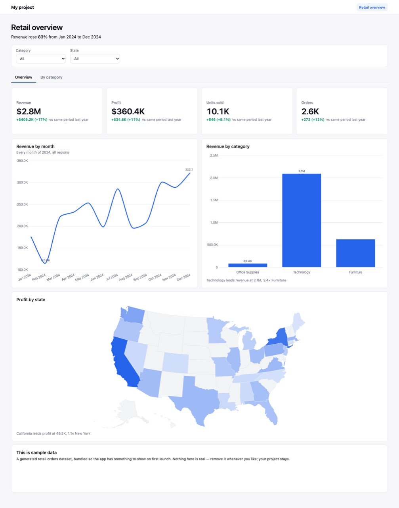 |
| 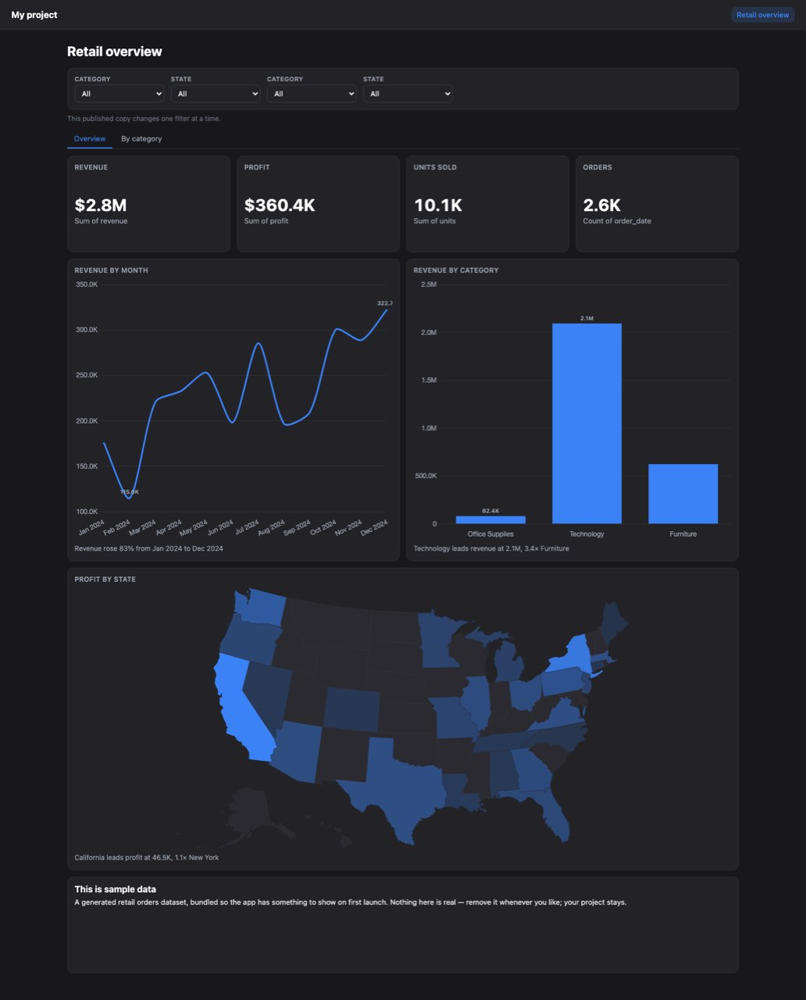 | 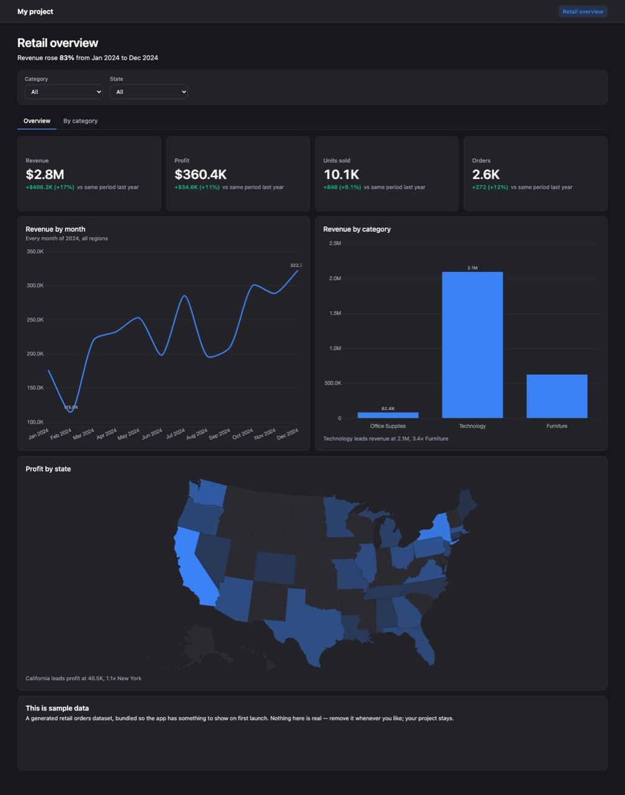 |

The wizard's brief, and a draft review:

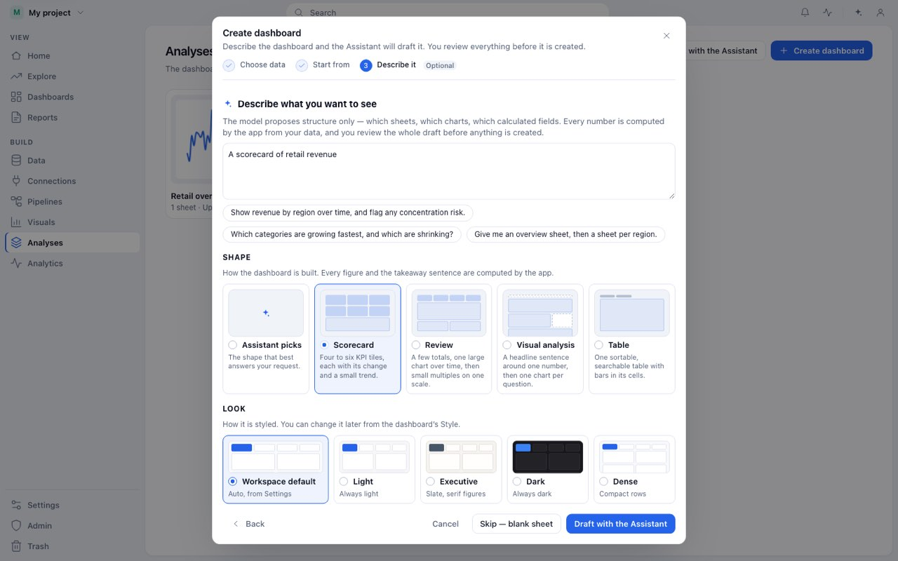
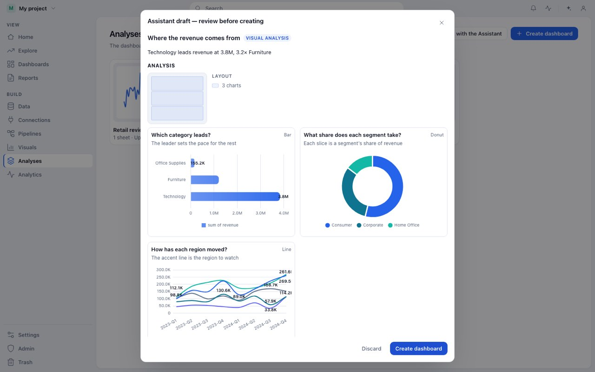

Each shape drafted on the sample's retail orders, on the canvas and published
(`web/e2e/shapes.e2e.ts` writes all of these, light and dark):

| Shape | Drafted | Published |
|---|---|---|
| Scorecard | 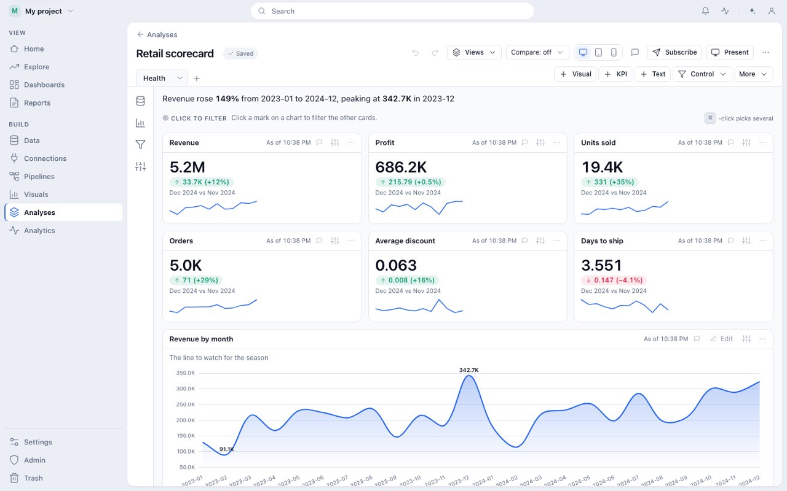 | 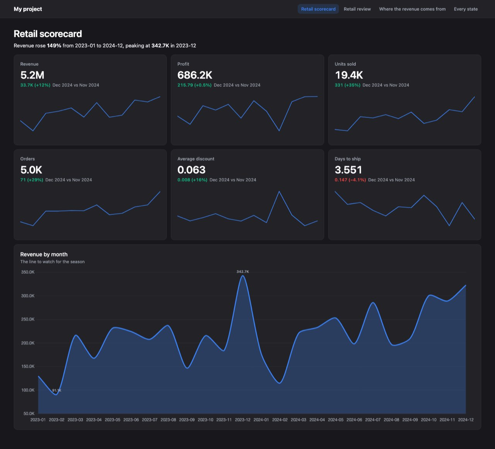 |
| Review | 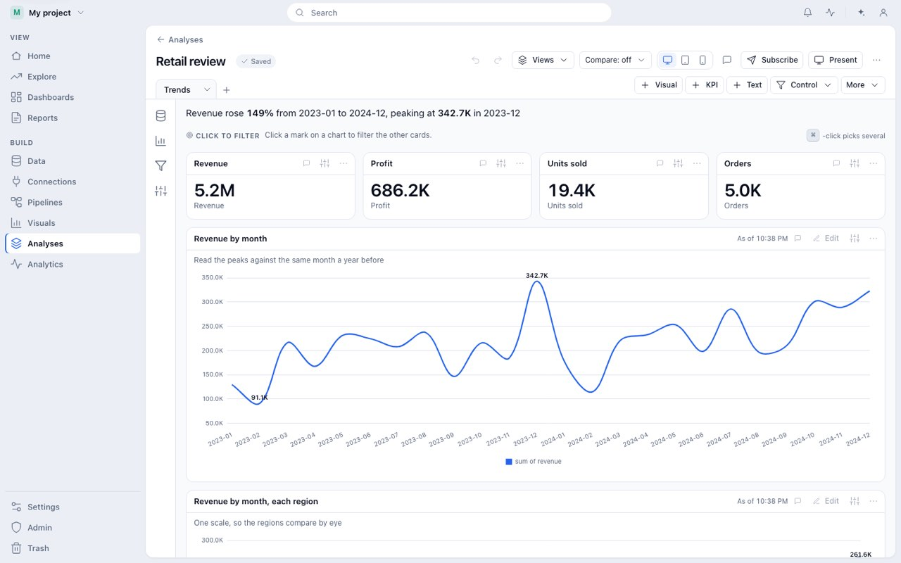 | 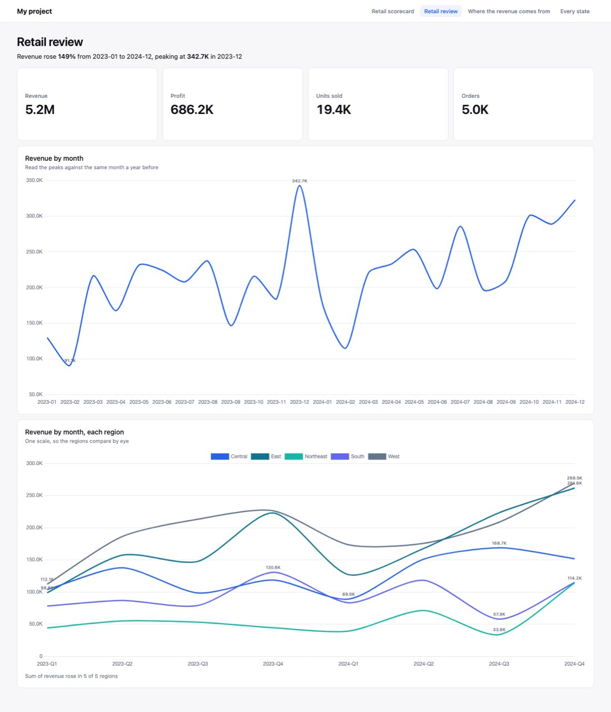 |
| Visual analysis | 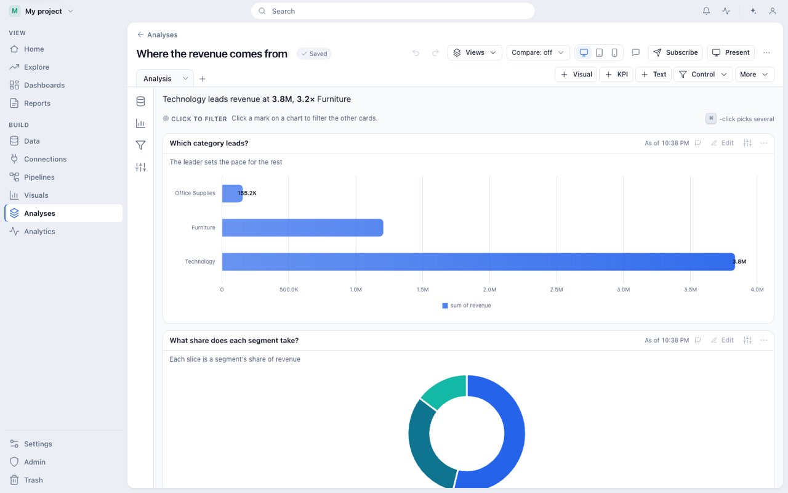 | 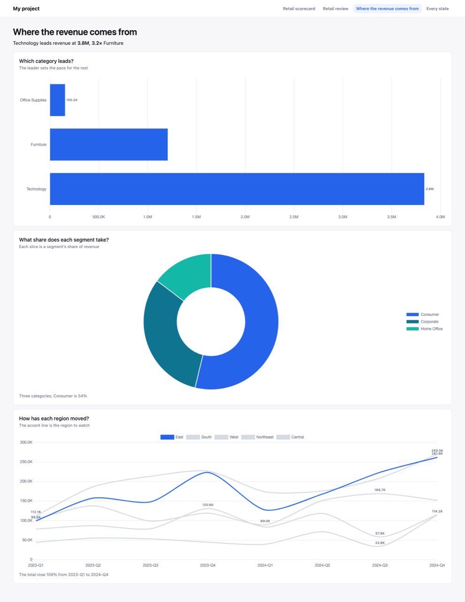 |
| Table | 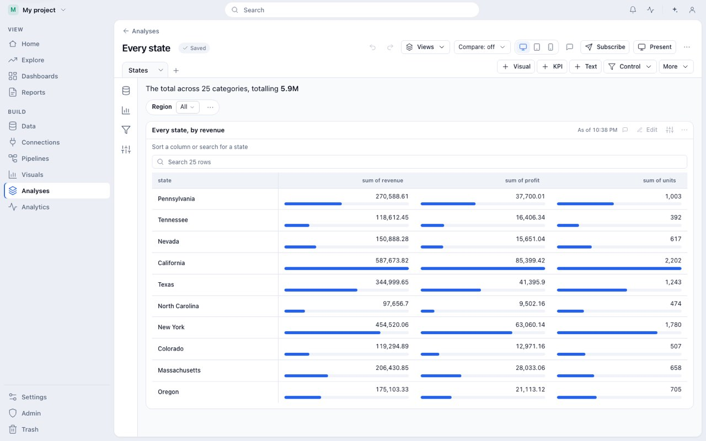 | 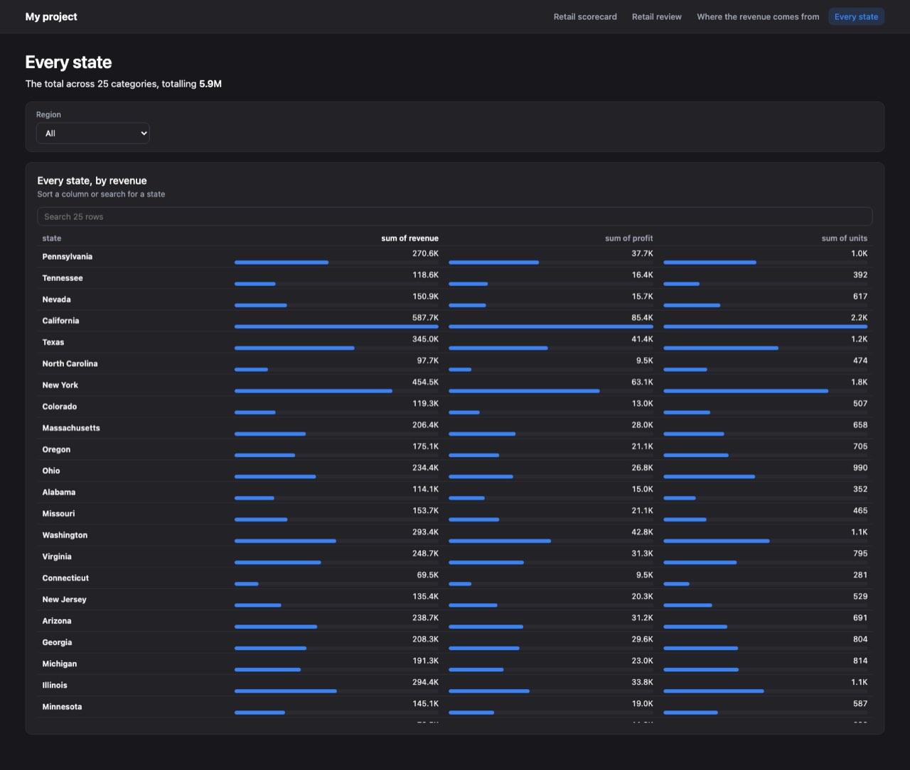 |

## Open

- A published treemap is still drawn as a table; Visual analysis suggests a donut for share first.
- A table's caption is the count sentence ("The total across 25 categories…"), pinned by
  `test-captions`; a ranking sentence would suit the Table shape better.
- A KPI trend is skipped under "As of" and a converted currency, and for a formula metric.
- Month keys in captions read "2023-01" where the axis may read "Jan 2023".
